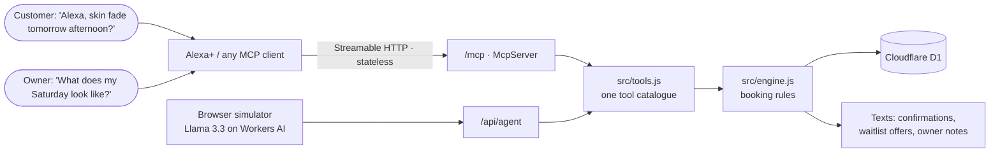
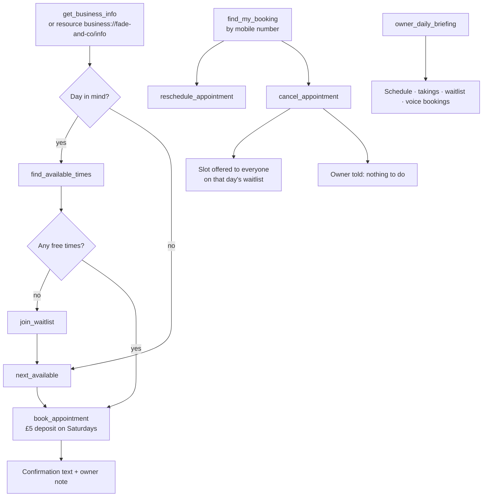

# Chair Ready Voice

**An MCP server that lets Alexa+ (or any AI agent) book appointments for one-person businesses — so the owner never has to pick up the phone.**

Demo business: **Fade & Co.**, a fictional one-chair barbershop in Dalston, London (demo data; the address is made up). Marcus works alone. Around 40 booking messages a day arrive while he's holding clippers; by the time he replies, customers have booked elsewhere, and one in five Saturday chairs is a no-show.

With Chair Ready Voice, a customer just says *"Alexa, can I get a skin fade at Fade & Co. tomorrow afternoon?"* — the assistant checks the real diary, offers free times, books, texts a confirmation, handles reschedules and cancellations, and fills cancelled slots from the waitlist. Marcus gets a heads-up, nothing to do.

- **Live simulator:** https://chair-ready-voice.fadeandco.workers.dev
- **MCP endpoint (Streamable HTTP, spec 2025-11-25):** `https://chair-ready-voice.fadeandco.workers.dev/mcp`
- **Agent Skill:** [`skills/book-appointment/SKILL.md`](skills/book-appointment/SKILL.md) — the same flow packaged as an open-standard Agent Skill
- **Submission docs:** [Devpost write-up](docs/DEVPOST.md) · [Friction log](docs/FRICTION-LOG.md) · [Video script](docs/VIDEO-SCRIPT.md)

## Why this matters

Most of the UK's barbers, nail techs, groomers and tattoo artists work alone. Their diary lives in their DMs, and they can't answer it while they're working. Every slow reply is a customer booking somewhere else; every no-show or late cancellation is an hour of income that can't be sold again.

Chair Ready Voice answers straight away, from the real diary, in the customer's own words. The Saturday deposit makes no-shows expensive, and the waitlist refill turns a cancellation into a text to everyone who wanted that day. The owner doesn't need to learn new software. They just stop losing bookings while they work.

## How it fits together





## Tools

| Tool | What it does |
|---|---|
| `get_business_info` | Name, address, opening hours, deposit rules, services with length and price |
| `find_available_times` | Genuinely free start times for a service on a date (hours, breaks, existing bookings, service length) |
| `next_available` | Next days with free times — for "when's your next slot?" |
| `book_appointment` | Books a free time, sends the confirmation, applies the Saturday deposit rule |
| `find_my_booking` | Upcoming bookings for a mobile number |
| `reschedule_appointment` | Moves a booking to a new free time |
| `cancel_appointment` | Cancels, refunds the deposit and **offers the freed slot to everyone on that day's waitlist** |
| `join_waitlist` | Puts a customer on a full day's waitlist |
| `owner_daily_briefing` | The owner's day: schedule, takings, waitlist, bookings that came in by voice |

Every tool declares an `outputSchema` and returns matching `structuredContent` (lists come as `{ items: [...] }`) plus a JSON text block. Read-only tools carry `readOnlyHint`; `cancel_appointment` carries `destructiveHint`. Errors come back as `isError` results with a sentence the assistant can say out loud ("3 pm isn't free on Friday. Closest free times: 3:15, 4:30.").

The server also offers a **resource**, `business://fade-and-co/info` (services, hours, deposit rule, today's date as JSON), and a **prompt**, `book_haircut` (optional `service`, `when`, `name`), which opens a booking conversation with the receptionist rules attached.

## Use it from any MCP client

```json
{
  "mcpServers": {
    "chair-ready-voice": { "type": "http", "url": "https://chair-ready-voice.fadeandco.workers.dev/mcp" }
  }
}
```

## Tests

```bash
npm install
npm test                      # 32 tests, no Cloudflare account needed
node test/mcp-client.mjs      # smoke test against the live deployment (makes and cancels a booking)
```

`npm test` runs the Node.js test runner against an in-memory SQLite (better-sqlite3) behind a small D1-compatible adapter ([`test/d1.mjs`](test/d1.mjs)), with the clock frozen. It covers availability (hours, break, bookings, service length, same-day buffer), the Saturday deposit, booking errors, phone matching, reschedule, cancel + waitlist cascade, the owner briefing, input validation, JSON schemas, and an end-to-end MCP session through the Worker's fetch handler using the official SDK client.

## The Alexa+ simulator

The web page simulates an Alexa+ device: tap the ring and speak (Web Speech API), or type. A small agent loop (Llama 3.3 70B on Workers AI, function calling) calls **the same tool implementations** the MCP server exposes, and the reply is spoken back. The right-hand panel shows what happens behind the scenes: every tool call, Marcus's chair for the day, and the messages sent automatically.

## Architecture

```
Alexa+ / any MCP client ──Streamable HTTP──►  /mcp  (McpServer, stateless)
Browser simulator ──► /api/agent (LLM + tool calls) ─┐
                                                     ├─► src/tools.js ─► src/engine.js ─► Cloudflare D1
Owner panel ──► /api/state ──────────────────────────┘
```

- `src/engine.js` — availability engine and booking rules (15-minute grid, breaks, deposits, waitlist cascade)
- `src/tools.js` — one tool catalogue (zod input and output schemas) used by both the MCP server and the agent
- `src/worker.js` — Cloudflare Worker: MCP transport, resource and prompt, agent loop, simulator API
- `schema.sql`, `src/seed.js` — database schema and demo data (relative to today)

## Run your own

```bash
npm install
npx wrangler d1 create chair-ready-voice      # put the id in wrangler.toml
npx wrangler d1 execute chair-ready-voice --remote --file schema.sql
npx wrangler deploy
curl -X POST https://<your-worker>/api/reset  # load demo data
```

Runs on the Cloudflare Workers free tier (Workers, D1, Workers AI).

## License

MIT
